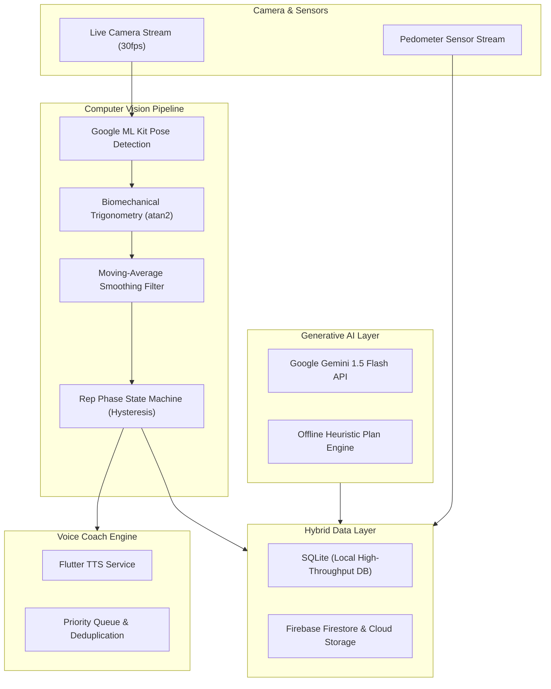

# LuminAI — Elite AI-Powered Personal Fitness Trainer

[](https://truckload-optimizer-eztke.web.app)
[](https://github.com/Prakhyat05/LuminAI/releases/latest)

[](https://flutter.dev)
[](https://dart.dev)
[](https://developers.google.com/ml-kit)
[](https://ai.google.dev)
[](https://truckload-optimizer-eztke.web.app)
[](https://sqlite.org)
[](https://opensource.org/licenses/MIT)

> **LuminAI** is a cross-platform mobile application that combines on-device computer vision, biomechanical coordinate geometry, and generative AI to deliver real-time exercise form analysis, rep tracking, and personalized coaching.
>
> 🌐 **Live Web Demo:** [https://truckload-optimizer-eztke.web.app](https://truckload-optimizer-eztke.web.app)  
> 📱 **Android Release APK:** [LuminAI-v1.0.0.apk](https://github.com/Prakhyat05/LuminAI/releases/latest)

---

## ⚡ Key Engineering Highlights

- **Real-Time On-Device Pose Tracking:** Ingests live 30fps camera frames using **Google ML Kit Pose Detection** to track 33 full-body landmarks with sub-30ms inference latency.
- **Biomechanical Joint Trigonometry:** Calculates 3-point joint angles dynamically using quadrant-aware vector mathematics (`atan2`) with running-average smoothing and hysteresis debouncing across 17 exercises.
- **Priority-Queued Voice Coach:** Asynchronous Text-to-Speech (TTS) engine with priority queues, message deduplication windows, cooldown timers, and milestone announcements.
- **Generative AI Workout Architect:** Integrates **Google Gemini 1.5 Flash** to synthesize tailored workout, nutrition, and recovery plans with instant offline heuristic fallback.
- **Hybrid Offline-First Persistence:** Dual-layer data architecture leveraging **SQLite** for high-throughput local telemetry and **Firebase Firestore** for cloud synchronization.
- **Developer & Recruiter Demo Mode:** One-tap guest access and camera simulator mode allowing instant evaluation on emulators and non-camera desktop environments.

---

## 🏛️ System Architecture



---

## 📐 Mathematical Formulation: Biomechanical Joint Tracking

For any anatomical joint triplet $B$ formed by adjacent body segments $A \to B$ and $B \to C$ (e.g., Shoulder $\to$ Elbow $\to$ Wrist):

1. **Segment Vectors:**
   $$\vec{BA} = (A_x - B_x, A_y - B_y), \quad \vec{BC} = (C_x - B_x, C_y - B_y)$$

2. **Quadrant-Aware Angle Computation:**
   $$\theta_{BA} = \text{atan2}(BA_y, BA_x), \quad \theta_{BC} = \text{atan2}(BC_y, BC_x)$$
   $$\Delta\theta = |\theta_{BA} - \theta_{BC}|$$
   $$\theta_{\text{joint}} = \begin{cases} \Delta\theta & \text{if } \Delta\theta \le \pi \\ 2\pi - \Delta\theta & \text{if } \Delta\theta > \pi \end{cases}$$

3. **Running-Average Noise Filter:**
   To eliminate jitter from lighting fluctuations and rapid movements:
   $$\bar{\theta}_t = \frac{1}{N} \sum_{i=0}^{N-1} \theta_{t-i}, \quad N = 5$$

4. **Hysteresis & State Transition:**
   Prevents double-counting around rep inflection points:
   $$\text{Phase } A \to B \iff \bar{\theta} \le (\theta_{\text{inflection}} - \epsilon)$$
   $$\text{Phase } B \to \text{Completed} \iff \bar{\theta} \ge (\theta_{\text{extension}} + \epsilon), \quad \epsilon = 5.0^\circ$$

---

## 📱 Supported Trackable Exercises

| Category | Exercises | Primary Biomechanical Metrics Tracked |
| :--- | :--- | :--- |
| **Upper Body** | Bicep Curls, Push-ups, Shoulder Press, Lateral Raises, Tricep Dips, Pull-ups | Elbow flexion angle, Shoulder abduction, Forearm verticality |
| **Lower Body** | Squats, Lunges, Bodyweight Squats, Calf Raises, Glute Bridges | Knee flexion angle, Hip hinge angle, Torso lean |
| **Core & Cardio** | Planks, Crunches, Jumping Jacks, Mountain Climbers, Burpees | Spine alignment, Hip horizontal drift, Plank hold duration |

---

## 🚀 Getting Started

### Prerequisites
- Flutter SDK `>=3.4.3 <4.0.0`
- Android Studio / Xcode
- Android Device (API 24+) or iOS Device (iOS 13+)

### Installation & Run

1. **Clone the repository:**
   ```bash
   git clone https://github.com/your-username/luminai.git
   cd luminai
   ```

2. **Install dependencies:**
   ```bash
   flutter pub get
   ```

3. **Run the app (with Gemini AI support):**
   ```bash
   flutter run --dart-define=GEMINI_API_KEY="your_gemini_api_key"
   ```
   *(If no API key is passed, the app automatically falls back to the built-in offline workout generator).*

4. **Run Automated Test Suite:**
   ```bash
   flutter test
   ```

---

## 📦 Production Builds & Deployment

### Build Release APK (Android)
```bash
flutter build apk --release --dart-define=GEMINI_API_KEY="your_api_key"
```
The installable APK will be generated at:
`build/app/outputs/flutter-apk/app-release.apk`

### Build Web Release
```bash
flutter build web --release --dart-define=GEMINI_API_KEY="your_api_key"
firebase deploy --only hosting
```

---

## 📄 License
This project is licensed under the MIT License — see the [LICENSE](LICENSE) file for details.
