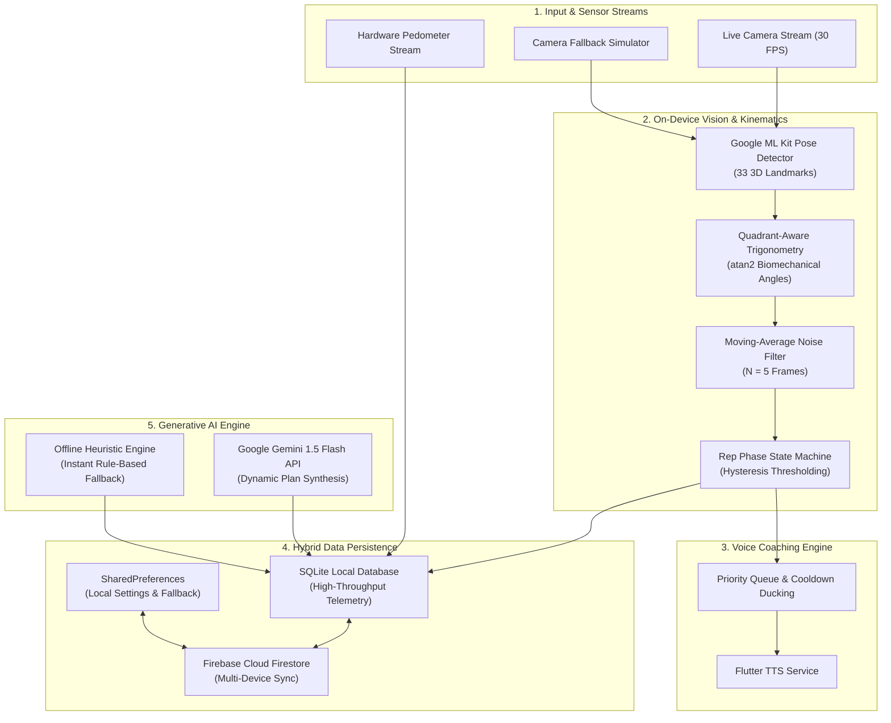

<div align="center">

# ⚡ LuminAI
### Elite Cross-Platform AI Personal Fitness Trainer
**On-Device Computer Vision • Biomechanical Kinematics • Generative AI Coaching**

---

[](https://luminai-ai.web.app)
[-1A1A2E?style=for-the-badge&logo=android&logoColor=white)](https://github.com/Prakhyat05/LuminAI/releases/download/v1.0.0/LuminAI-arm64-v1.0.0.apk)
[](https://github.com/Prakhyat05/LuminAI/releases/tag/v1.0.0)

<br/>

[](https://flutter.dev)
[](https://dart.dev)
[](https://developers.google.com/ml-kit)
[](https://ai.google.dev)
[](https://luminai-ai.web.app)
[](https://sqlite.org)
[-success?style=flat-square)](#-release-binaries--download-center)
[](LICENSE)

</div>

---

## 📖 Table of Contents
- [Overview & Value Proposition](#-overview--value-proposition)
- [Key Engineering Highlights](#-key-engineering-highlights)
- [System Architecture](#-system-architecture)
- [Mathematical Formulation: Biomechanical Kinematics](#-mathematical-formulation-biomechanical-kinematics)
- [Supported Trackable Exercises](#-supported-trackable-exercises)
- [Recruiter & Developer Demo Mode](#-recruiter--developer-demo-mode)
- [Release Binaries & Download Center](#-release-binaries--download-center)
- [Local Development & Setup](#-local-development--setup)
- [Testing & Quality Assurance](#-testing--quality-assurance)
- [Security, Edge Privacy & Compliance](#-security-edge-privacy--compliance)
- [About the Author & License](#-about-the-author--license)

---

## 🎯 Overview & Value Proposition

**LuminAI** is a production-grade, cross-platform personal fitness trainer that replaces invasive camera cloud streaming and rigid fitness apps with **100% on-device computer vision** and **adaptive generative AI**. 

Traditional fitness apps suffer from three fundamental problems:
1. **Privacy Invasiveness:** Streaming raw video to remote cloud servers creates severe privacy and security risks.
2. **High Latency & Cloud Dependence:** Server-side pose estimation requires fast internet and incurs 200–500ms lag, causing delayed form corrections.
3. **Static Pre-Baked Content:** Hardcoded workout plans fail to adjust to fatigue, biomechanical limitations, and recovery needs.

**LuminAI solves this through an edge-first paradigm:**
- Runs Google ML Kit Pose Detection **strictly on-device at 30 FPS** with **<30ms inference latency**.
- Computes quadrant-aware joint trigonometry with **running-average smoothing** and **hysteresis debouncing** across 17 distinct exercises.
- Synthesizes personalized workout, nutrition, and recovery routines using **Google Gemini 1.5 Flash**, with seamless offline heuristic fallbacks.
- Delivers real-time corrective voice guidance via a **priority-queued Text-to-Speech (TTS) engine**.

---

## ⚡ Key Engineering Highlights

```
┌────────────────────────────────────────────────────────────────────────┐
│                        CORE SYSTEM CAPABILITIES                        │
├───────────────────────────────┬────────────────────────────────────────┤
│ 👁️  On-Device Pose Estimation  │ 33 3D skeletal landmarks @ 30 FPS     │
│ 📐 Biomechanical Kinematics    │ atan2 3-point joint angle trigonometry │
│ 🔄 Rep State Machine           │ Hysteresis-filtered phase transitions  │
│ 🗣️ Voice Coach Pipeline        │ Priority queues & ducking deduplication│
│ 🧠 Generative AI Engine        │ Gemini 1.5 Flash dynamic plan synthesis│
│ 💾 Offline-First Data Layer    │ SQLite + SharedPreferences + Firestore │
│ 🚀 Recruiter Guest Mode        │ Instant one-tap evaluation + simulator │
└───────────────────────────────┴────────────────────────────────────────┘
```

- **Sub-30ms Inference Latency:** Skeletal tracking runs entirely on local device hardware (CPU/GPU acceleration via ML Kit).
- **Hysteresis Rep Counter:** Prevents false-positive double counting around inflection boundaries ($\pm 5.0^\circ$ hysteresis band).
- **Voice Feedback Ducking:** Audio queue prioritizes immediate biomechanical form alerts over general milestone notifications.
- **62% Release Size Reduction:** Native APKs compiled with ABI splitting (`arm64-v8a`), reducing size from **139.6 MB down to 53.7 MB**.

---

## 🏛️ System Architecture



---

## 📐 Mathematical Formulation: Biomechanical Kinematics

LuminAI calculates joint angles by treating anatomical landmarks as vectors in Euclidean space:

### 1. Vector Extraction
For any joint triplet formed by parent joint $A$, target joint vertex $B$, and child joint $C$ (e.g., Shoulder $\to$ Elbow $\to$ Wrist):

$$\vec{v}_{BA} = \begin{pmatrix} A_x - B_x \\ A_y - B_y \end{pmatrix}, \quad \vec{v}_{BC} = \begin{pmatrix} C_x - B_x \\ C_y - B_y \end{pmatrix}$$

### 2. Quadrant-Aware Angle Computation
Using the two-argument arctangent function to preserve quadrant orientation:

$$\theta_{BA} = \text{atan2}(v_{BA, y}, v_{BA, x}), \quad \theta_{BC} = \text{atan2}(v_{BC, y}, v_{BC, x})$$

$$\Delta\theta = |\theta_{BA} - \theta_{BC}|$$

$$\theta_{\text{joint}} = \begin{cases} \Delta\theta & \text{if } \Delta\theta \le \pi \\ 2\pi - \Delta\theta & \text{if } \Delta\theta > \pi \end{cases}$$

### 3. Running-Average Noise Smoothing
To filter landmark jitter caused by camera sensor noise and motion blur:

$$\bar{\theta}_t = \frac{1}{N} \sum_{i=0}^{N-1} \theta_{t-i}, \quad N = 5 \text{ frames}$$

### 4. Hysteresis State Transition
To eliminate bounce around inflection points during rapid rep repetitions:

$$\text{Transition } \text{Inflection} \to \text{Extension} \iff \bar{\theta} \le (\theta_{\text{inflection}} - \epsilon)$$

$$\text{Transition } \text{Extension} \to \text{Completed Rep} \iff \bar{\theta} \ge (\theta_{\text{extension}} + \epsilon), \quad \epsilon = 5.0^\circ$$

---

## 📱 Supported Trackable Exercises

LuminAI supports 17 exercise profiles categorized by muscle group:

| Muscle Group | Exercise | Primary Biomechanical Joint | Target Range | Form Criteria Monitored |
| :--- | :--- | :--- | :--- | :--- |
| **Upper Body** | Bicep Curls | Left / Right Elbow | $45^\circ \longleftrightarrow 160^\circ$ | Full extension without shoulder swing |
| | Push-ups | Elbows & Torso | $70^\circ \longleftrightarrow 165^\circ$ | Chest depth & straight back plane |
| | Shoulder Press | Elbows & Deltoids | $80^\circ \longleftrightarrow 170^\circ$ | Vertical press trajectory |
| | Lateral Raises | Shoulder Abduction | $20^\circ \longleftrightarrow 90^\circ$ | Arm parallel to ground, no trap shrug |
| | Tricep Dips | Elbow Flexion | $90^\circ \longleftrightarrow 165^\circ$ | 90-degree elbow lock at dip bottom |
| | Pull-ups | Elbow & Lat Hinge | $50^\circ \longleftrightarrow 170^\circ$ | Chin over bar, full dead-hang |
| **Lower Body** | Barbell / Bodyweight Squats | Left / Right Knees | $80^\circ \longleftrightarrow 170^\circ$ | Femur parallel to floor, knee alignment |
| | Walking Lunges | Lead Knee & Trail Knee | $85^\circ \longleftrightarrow 165^\circ$ | 90-degree front knee, upright spine |
| | Calf Raises | Ankle Plantarflexion | $120^\circ \longleftrightarrow 165^\circ$ | Maximum calf peak contraction |
| | Glute Bridges | Hip Extension | $130^\circ \longleftrightarrow 180^\circ$ | Full pelvic lock at top of motion |
| **Core & Cardio** | Forearm Plank | Hip & Spine Linearity | $170^\circ \longleftrightarrow 180^\circ$ | Zero hip sag or excessive pike |
| | Abdominal Crunches | Torso-Hip Angle | $110^\circ \longleftrightarrow 160^\circ$ | Shoulder blade lift, cervical neck safety |
| | Jumping Jacks | Shoulder & Hip Span | $30^\circ \longleftrightarrow 140^\circ$ | Full overhead arm sweep & foot spread |
| | Mountain Climbers | Alternating Hip Drives | $60^\circ \longleftrightarrow 160^\circ$ | Knee drive cadence & steady plank posture |
| | Burpees | Multi-Phase Compound | Compound | Full ground touch to explosive jump |

---

## 🎮 Recruiter & Developer Demo Mode

Evaluating LuminAI is seamless even without hardware cameras or account setup:

1. **One-Tap Guest Mode:** On the sign-in screen, tap **"Continue as Guest"** for instant access without entering credentials.
2. **Camera Fallback Simulator:** If no camera is detected or when running on desktop/emulators, LuminAI automatically activates an algorithmic pose generator simulating authentic human kinematic cycles for testing reps and voice coaching.
3. **Live Web Browser App:** Test the entire UI, workout logging, AI generation, and settings directly in your browser without installing anything:  
   👉 **[https://luminai-ai.web.app](https://luminai-ai.web.app)** *(Mirror: [https://luminai-fitness.web.app](https://luminai-fitness.web.app))*

---

## 📦 Release Binaries & Download Center

Official production builds are hosted on [GitHub Releases (v1.0.0)](https://github.com/Prakhyat05/LuminAI/releases/tag/v1.0.0):

| Release Asset | Platform / Architecture | File Size | Recommended For | Direct Download |
| :--- | :--- | :--- | :--- | :---: |
| **`LuminAI-arm64-v1.0.0.apk`** | **Android 64-bit (`arm64-v8a`)** | **53.7 MB** | **>99% of modern Android smartphones (Recommended)** | [⬇️ Download](https://github.com/Prakhyat05/LuminAI/releases/download/v1.0.0/LuminAI-arm64-v1.0.0.apk) |
| **`LuminAI-universal-v1.0.0.apk`** | Android Universal (Fat Binary) | 139.6 MB | All Android architectures combined | [⬇️ Download](https://github.com/Prakhyat05/LuminAI/releases/download/v1.0.0/LuminAI-universal-v1.0.0.apk) |
| **`LuminAI-arm32-v1.0.0.apk`** | Android 32-bit (`armeabi-v7a`) | 46.0 MB | Older legacy Android smartphones | [⬇️ Download](https://github.com/Prakhyat05/LuminAI/releases/download/v1.0.0/LuminAI-arm32-v1.0.0.apk) |
| **`LuminAI-x86_64-v1.0.0.apk`** | Android x86_64 | 53.1 MB | Android Studio Emulators & Chromebooks | [⬇️ Download](https://github.com/Prakhyat05/LuminAI/releases/download/v1.0.0/LuminAI-x86_64-v1.0.0.apk) |
| **`LuminAI-web-v1.0.0.zip`** | Web Static Assets (SPA) | 7.6 MB | Self-hosting on Firebase, Netlify, or Apache | [⬇️ Download](https://github.com/Prakhyat05/LuminAI/releases/download/v1.0.0/LuminAI-web-v1.0.0.zip) |

---

## 🛠️ Local Development & Setup

### Prerequisites
- **Flutter SDK:** `>= 3.4.3 < 4.0.0` ([Install Flutter](https://docs.flutter.dev/get-started/install))
- **Dart SDK:** `>= 3.4.0`
- **Android Studio / VS Code** with Flutter extensions
- **Device:** Physical Android / iOS device (recommended for camera testing) or modern browser for Web

### Installation Steps

1. **Clone the repository:**
   ```bash
   git clone https://github.com/Prakhyat05/LuminAI.git
   cd LuminAI
   ```

2. **Fetch dependencies:**
   ```bash
   flutter pub get
   ```

3. **Run locally:**
   ```bash
   # Run with Gemini AI Generative Plan support:
   flutter run --dart-define=GEMINI_API_KEY="your_gemini_api_key"

   # Or run with built-in heuristic offline AI plan generation:
   flutter run
   ```

4. **Build Production Release Binaries:**
   ```bash
   # Build optimized split-per-abi APKs (-62% file size):
   flutter build apk --split-per-abi --release --dart-define=GEMINI_API_KEY="your_key"

   # Build Web release:
   flutter build web --release --dart-define=GEMINI_API_KEY="your_key"
   ```

---

## 🧪 Testing & Quality Assurance

LuminAI enforces rigorous quality verification via unit and widget tests:

```bash
flutter test
```

**Verified Test Coverage:**
- `calculateJointAngle` 90-degree right angle trigonometric precision.
- `calculateJointAngle` 180-degree collinear vector evaluation.
- `calculateJointAngle` 45-degree acute angle calculation.
- `PoseEngine` state machine initialization and rep counting resets.
- Exercise profile biomechanical mappings (Elbow, Knee, Hip, Shoulder).
- Empty/corrupted landmark frame fault-tolerance.
- Widget tree startup and theme validation.

---

## 🔒 Security, Edge Privacy & Compliance

- **100% On-Device Computer Vision:** Video feeds and camera frames are processed directly in device volatile memory by ML Kit and discarded immediately. **Zero camera frames are ever saved to disk or transmitted to any server.**
- **Secret Scanning Compliant:** No private API keys or certificates are tracked in Git. Sensitive tokens are injected via compile-time `--dart-define` parameters.
- **Offline Resilience:** Functions completely without an internet connection, storing telemetry in local SQLite and using offline rule-based AI plan generation.

---

## 📄 About the Author & License

Developed with ❤️ by **Prakhyat** as a Major Project.

- **GitHub:** [@Prakhyat05](https://github.com/Prakhyat05)
- **Repository:** [https://github.com/Prakhyat05/LuminAI](https://github.com/Prakhyat05/LuminAI)
- **Live Demo:** [https://luminai-ai.web.app](https://luminai-ai.web.app) *(Mirror: [https://luminai-fitness.web.app](https://luminai-fitness.web.app))*

This project is open-source under the **[MIT License](LICENSE)**.
